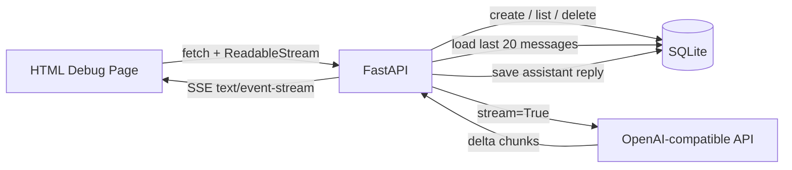
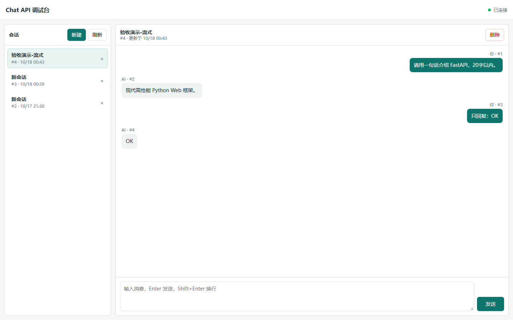
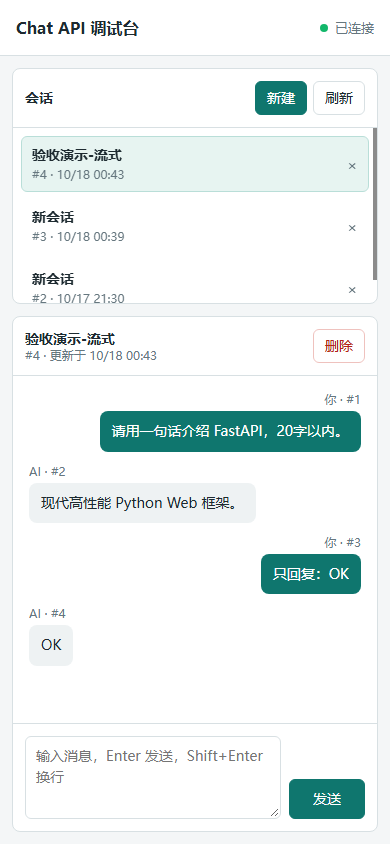
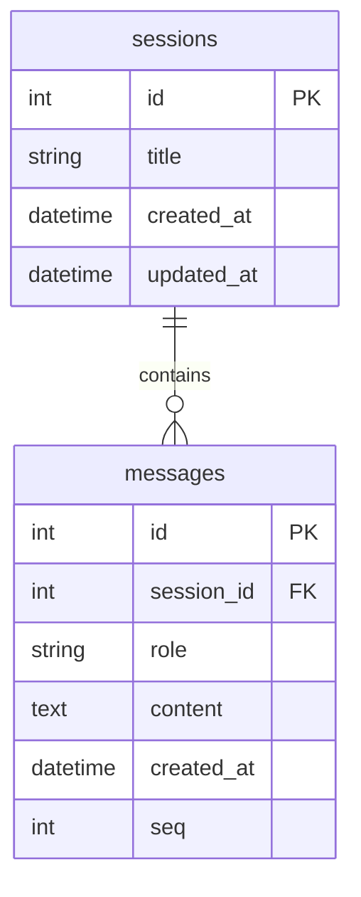

# AI Stream Chat Backend

一个基于 **FastAPI + SQLAlchemy 2.0 + AsyncOpenAI** 的 AI 对话后端个人项目，包含会话持久化、SSE 流式输出、上下文截断、异常处理和 HTML 调试页。

> 项目定位：AI 应用后端基础项目，正在向电商场景（商品评论洞察 / 客服 Agent）迭代。当前不是商业项目，也尚未部署到公网。

## 项目亮点

- 5 个会话/消息 REST 接口，覆盖创建、列表、历史查询、删除和聊天。
- SQLite 持久化 `sessions` / `messages`，服务重启后历史仍可读取。
- 基于 `AsyncOpenAI + StreamingResponse` 实现 SSE 流式返回。
- 只取最近 20 条消息作为模型上下文，避免上下文无限增长。
- 流式生成器内独立管理数据库 session，避免长连接期间 session 失效。
- 用户消息先落库，完整 AI 回复在流结束后一次性落库，避免逐 token 写库。
- logging、全局异常处理、SSE 错误事件、404 校验和级联删除。
- 16 项可重复运行的冒烟测试，覆盖接口契约、会话隔离、上下文截断和持久化。
- 原生 HTML/JS 调试页，支持会话切换、历史回显和流式渲染。

## 架构



请求链路：

1. 前端发送 `POST /sessions/{id}/chat`。
2. 后端先校验会话，再把用户消息写入数据库。
3. 后端读取最近 20 条消息，追加当前用户消息，调用模型流式接口。
4. 模型 chunk 逐段转换成 SSE 事件返回前端。
5. 流结束后，后端把完整 AI 回复一次性写入数据库。

## 技术栈

| 层次 | 技术 |
| --- | --- |
| Web 框架 | FastAPI |
| 数据校验 | Pydantic |
| ORM | SQLAlchemy 2.0 |
| 数据库 | SQLite（开发环境） |
| 模型调用 | AsyncOpenAI |
| 流式协议 | SSE（`text/event-stream`） |
| 调试页 | 原生 HTML + JavaScript + Fetch ReadableStream |
| 测试 | 可重复运行的 Python 冒烟测试脚本 |

## 目录结构

```text
chat-backed/
├── main.py                 # FastAPI、SQLAlchemy、SSE 和接口实现
├── debug.html              # HTML/JS 调试页
├── smoke_test.py           # 16 项冒烟测试
├── requirements.txt
├── .env.example            # 环境变量模板（不含真实密钥）
├── .gitignore
└── docs/
    ├── debug-page-desktop.png
    ├── debug-page-mobile.png
    └── DEMO_SCRIPT.md      # 90 秒演示录制脚本
```

## 快速开始

### 1. 环境要求

- Python 3.12+
- 一个兼容 OpenAI Chat Completions 的模型服务

### 2. 安装依赖

Windows PowerShell：

```powershell
cd E:\learn-fastapi\chat-backed
python -m venv .venv
.\.venv\Scripts\Activate.ps1
pip install -r requirements.txt
```

macOS / Linux：

```bash
cd chat-backed
python3 -m venv .venv
source .venv/bin/activate
pip install -r requirements.txt
```

### 3. 配置环境变量

Windows PowerShell：

```powershell
Copy-Item .env.example .env
```

macOS / Linux：

```bash
cp .env.example .env
```

编辑 `.env`：

```dotenv
OPENAI_BASE_URL=https://your-provider.example.com/v1
OPENAI_API_KEY=your-api-key
OPENAI_MODEL=your-model-name
```

`.env` 已加入 `.gitignore`，不要提交真实密钥。

### 4. 启动服务

```powershell
python -m uvicorn main:app --host 127.0.0.1 --port 8000 --reload
```

打开：

- 调试页：<http://127.0.0.1:8000/>
- Swagger：<http://127.0.0.1:8000/docs>

## 界面

| 桌面端 | 移动端 |
| --- | --- |
|  |  |

## API

| 方法 | 路径 | 作用 |
| --- | --- | --- |
| `POST` | `/sessions` | 新建会话，返回 `session_id` |
| `GET` | `/sessions` | 获取会话列表 |
| `GET` | `/sessions/{session_id}/messages` | 获取会话历史消息 |
| `DELETE` | `/sessions/{session_id}` | 删除会话及关联消息 |
| `POST` | `/sessions/{session_id}/chat` | 发送消息，SSE 流式返回 |

### 请求与响应示例

新建会话：

```powershell
curl.exe -X POST http://127.0.0.1:8000/sessions `
  -H "Content-Type: application/json" `
  -d '{"title":"demo"}'
```

返回：

```json
{
  "id": 1,
  "title": "demo",
  "created_at": "2026-10-18T00:00:00",
  "updated_at": "2026-10-18T00:00:00"
}
```

发送流式消息（把 `1` 换成真实会话 id）：

```powershell
curl.exe -N -X POST http://127.0.0.1:8000/sessions/1/chat `
  -H "Content-Type: application/json" `
  -d '{"content":"请用一句话介绍 FastAPI"}'
```

SSE 输出示例：

```text
data: {"delta": "FastAPI"}

data: {"delta": " 是一个"}

data: {"delta": " Python Web 框架"}

data: [DONE]
```

查询历史：

```powershell
curl.exe http://127.0.0.1:8000/sessions/1/messages
```

## 数据模型



## SSE 关键设计

### 1. 流式生成器内独立管理数据库会话

请求级 `db` 可能在流式响应期间被关闭，因此在生成器内部使用 `SessionLocal()` 新开一个 session，并在 `finally` 中关闭。

### 2. 用户消息先写，AI 回复结束后一次写

- 用户消息在调用模型前写入，保证请求有记录。
- AI 回复只在流结束后写入一条，避免每个 token 都执行一次数据库写入。

### 3. 只保留最近 20 条上下文

`get_recent_messages_by_session_id()` 先按 `seq` 倒序取 20 条，再翻转成时间正序，最后追加当前用户消息。第 21 条之后也不会算错 `seq`。

### 4. SSE 错误事件

模型流式调用失败时，接口返回：

```text
data: {"error": "模型调用失败，请稍后重试"}

data: [DONE]
```

同时记录完整 traceback，便于定位问题。

## 测试

运行冒烟测试：

```powershell
python smoke_test.py
```

测试使用假模型流，不消耗模型额度，覆盖：

- HTML 调试页和 `/docs`
- 5 个接口
- SSE Content-Type 与 `[DONE]`
- 用户消息和完整回复落库
- 会话隔离
- 最近 20 条上下文
- `seq` 连续性
- 删除会话级联删除消息

真实模型验证：

```powershell
curl.exe -N -X POST http://127.0.0.1:8000/sessions/1/chat `
  -H "Content-Type: application/json" `
  -d '{"content":"只回复：OK"}'
```

## 已知限制

- 当前使用 SQLite，适合本地开发；生产环境建议换成 PostgreSQL。
- 暂未加入用户认证、限流和权限控制。
- 暂未部署到公网，也没有真实用户和业务指标。
- 当前模型供应商存在输出缓冲，SSE 协议正常，但视觉上可能表现为延迟后集中返回。
- 当前是 AI 应用后端基础项目，尚未实现电商业务功能。

## Roadmap

- **第 2 周**：function calling、JSON schema、上下文与 token 成本、LangGraph。
- **第 3-4 周**：RAG、pgvector、混合检索、rerank、评测集与 Langfuse。
- **第 5 周**：Next.js 前端、Docker、云服务器、Nginx、HTTPS。
- **第 6 周**：电商垂直场景，例如商品评论洞察或客服 Agent。
- **第 7 周**：简历、GitHub 整理、演示视频和面试准备。

## 安全说明

- 仓库只提交 `.env.example`，真实 `.env` 不会进入 Git。
- 不要把 API Key、数据库文件或客户数据提交到公开仓库。
- 如果密钥曾进入提交历史，请立即在模型服务商后台轮换密钥。
